# OpenBox — Technical Specification

## 1. Access model

- Each file has one **owner**. Only the owner can rename a file, share it, or see who has access.
- The owner shares a file by creating a **share link**. Anyone signed in who opens the link gets the permissions the link gives, on that one file. Files can't be shared with a person directly; links are the only way to get access.
- People who got a file through a link can't share it further: they can't create links or pass their access on.
- Every link gives `view`.

| Permission | Allows |
|---|---|
| `view` | See and download |
| `edit` | Replace the contents |
| `delete` | Delete permanently, for everyone |

A link stops accepting new people at `expires_at`; people who already joined keep their access. Someone who joins through several links holds the permissions of all of them, and `permissions` in the API is the union. The owner can remove a person, which removes all of their access, or delete a link, which removes everyone who joined through it. People the owner removes can't rejoin through the links that existed when they were removed.

The app shows permission sets by name: **Can view** = `view`, **Can edit** = `view` + `edit`, **Can delete** = `view` + `delete`, **Full access** = all three.

## 2. Flows

### List files

The app asks for the first 50 files, then the next 50 each time the user scrolls to the end.


### Upload a file

The browser sends the bytes straight to storage. The API hands out a signed upload URL that accepts at most the declared size and only the declared type, then marks the file ready.

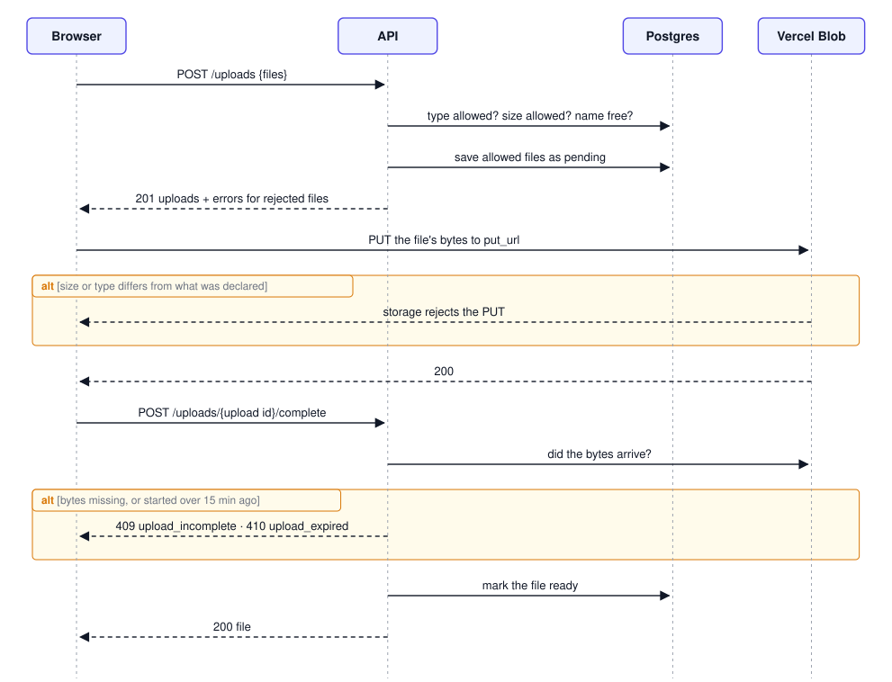

### Download a file

Files are downloaded one at a time. The API checks that the user can see the file and returns a signed storage URL valid for 60 seconds. The browser downloads straight from storage.


### Open a share link

Opening a link needs an account. Someone who isn't signed in goes through sign-in and lands back on the link, which then grants them access.

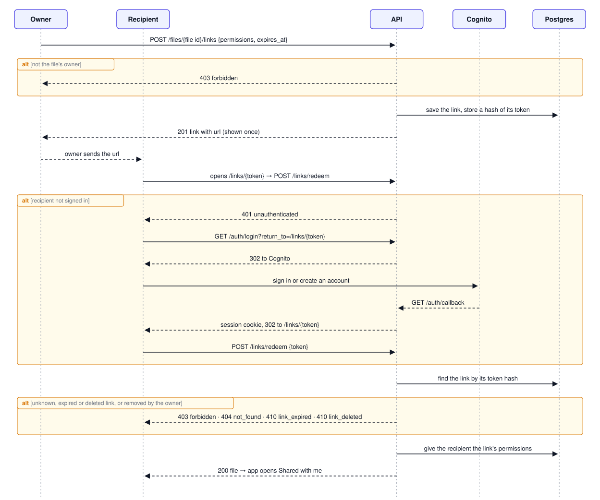

### Delete files

Deleting is permanent for everyone, so the app asks for confirmation first. The API removes the stored bytes in the same request.

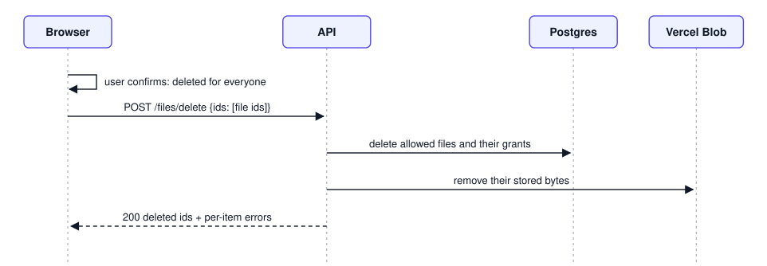

## 3. Screens

### Landing

Signed-out home page.

| Desktop | Mobile |
|---|---|
|  |  |

### Sign in

Cognito Managed Login with OpenBox branding. Sign-up (name, email, password) and the email code are Cognito's pages too, and so are their errors, such as a wrong password.

| Desktop | Mobile |
|---|---|
|  |  |

### Files: several selected

My files lists every file you own. Selecting files opens a toolbar at the bottom (desktop) or an action sheet (mobile) with only the actions the selection allows. Download needs exactly one file selected; several files can only be deleted together. On mobile, + opens Upload; ⋯ on a row opens the same sheet.

| Desktop | Mobile |
|---|---|
| 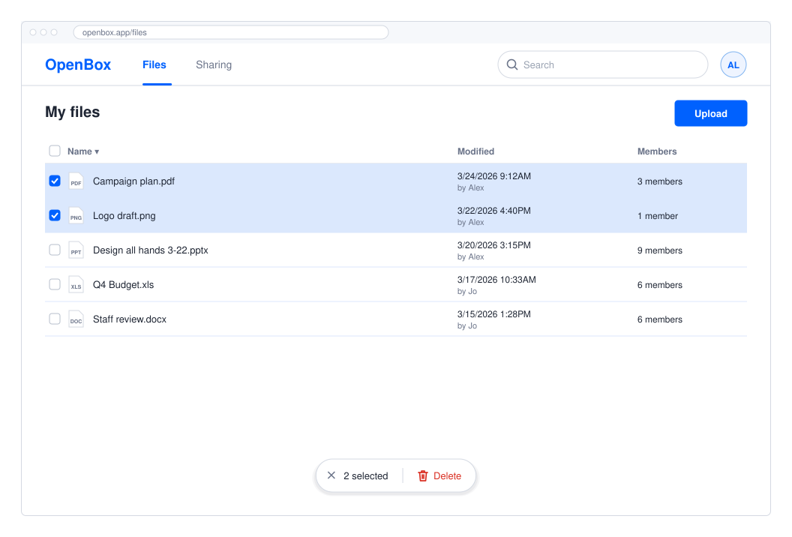 | 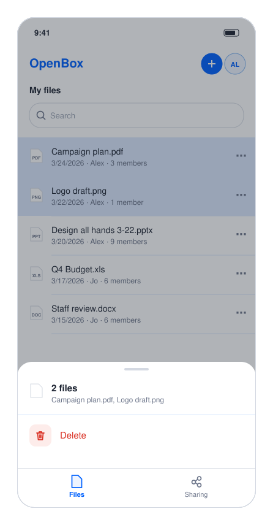 |

### Files: file selected

The owner gets every action, and only the owner sees Share. Replace asks first, then uploads the new contents through the upload panel.

| Desktop | Mobile |
|---|---|
| 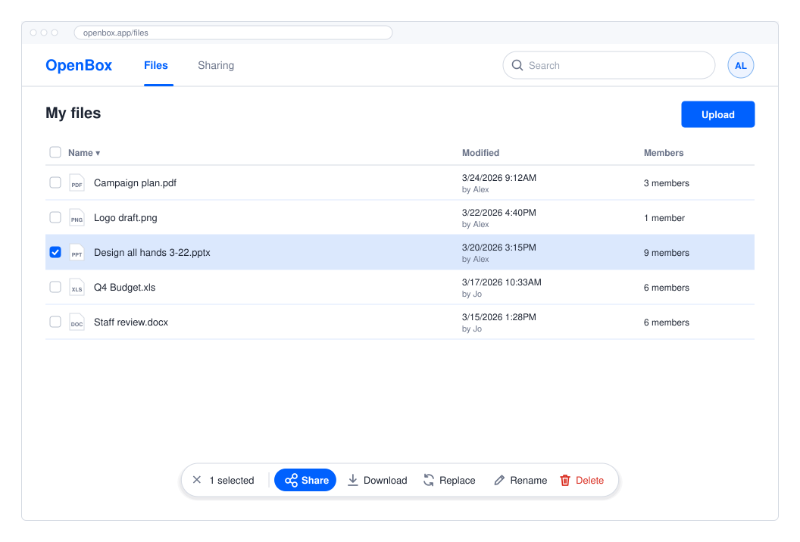 | 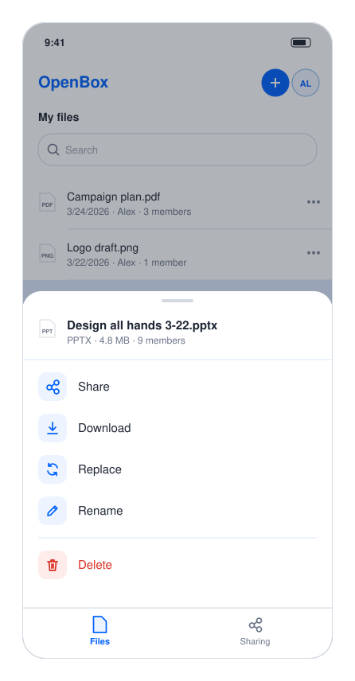 |

### Upload

Upload opens the file picker; files can also be dropped on the list. Each file uploads on its own: finished files join the list, rejected ones show the reason, and the rest keep going. Type and size are checked against `upload_policy` before Start upload, so each rejected file gets its own reason. On mobile, progress shows in a bottom sheet above the tab bar. A failed or expired upload shows Try again. Cancel stops an upload; its reserved name frees up when it expires. While files are dragged over the list, it shows a dashed outline and “Drop to upload”.

| Desktop | Mobile |
|---|---|
| 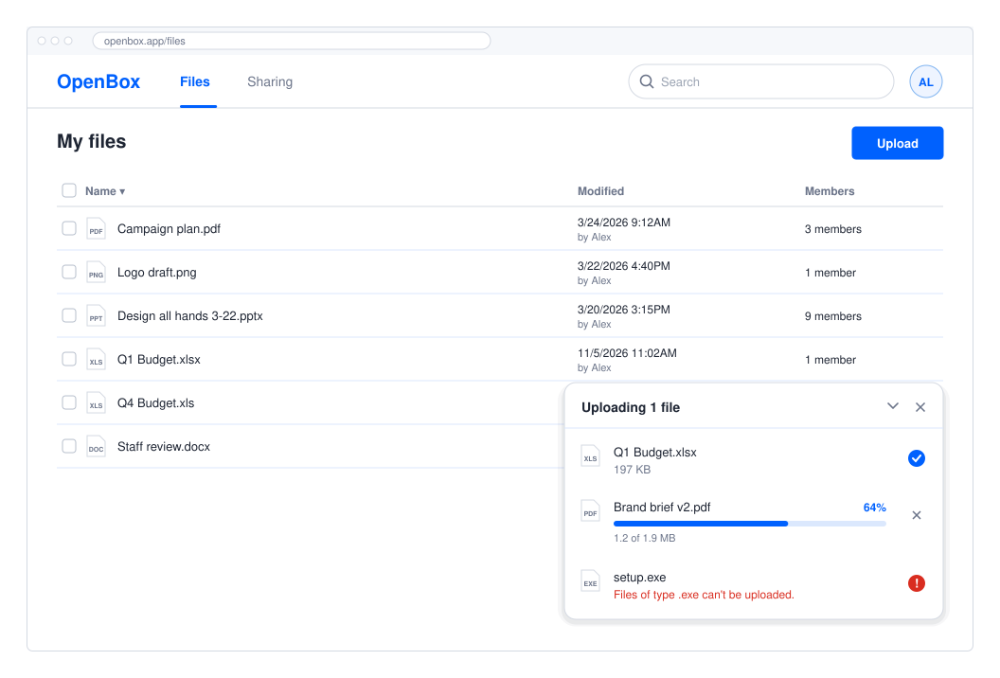 | 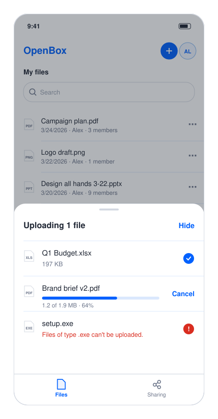 |

### Rename

Only the owner can rename a file. Rename opens a dialog filled with the current name. Empty names, names over 255 characters and names with / are caught as you type; a taken name is caught when the server answers.

| Desktop | Mobile |
|---|---|
|  |  |

### Confirm delete

Delete always asks first and names what goes. On mobile the same dialog fills the width.

| Desktop | Mobile |
|---|---|
|  |  |

### Sharing: file you can edit

Kate joined Q4 Budget.xls through a Can edit link. Files shared with you never show Share: only the owner can share a file. Shared by me shows Members instead of Owner.

| Desktop | Mobile |
|---|---|
|  |  |

### Sharing: view-only file

Kate can only view Brand guide.pdf.

| Desktop | Mobile |
|---|---|
|  |  |

### Share: people

Share shows only on files you own. People lists everyone who joined through a link, with the access they hold; they scroll inside a fixed-height list. × removes all of a person's access, and they can't rejoin through the existing links. On mobile, rows leave out when they joined.

| Desktop | Mobile |
|---|---|
| 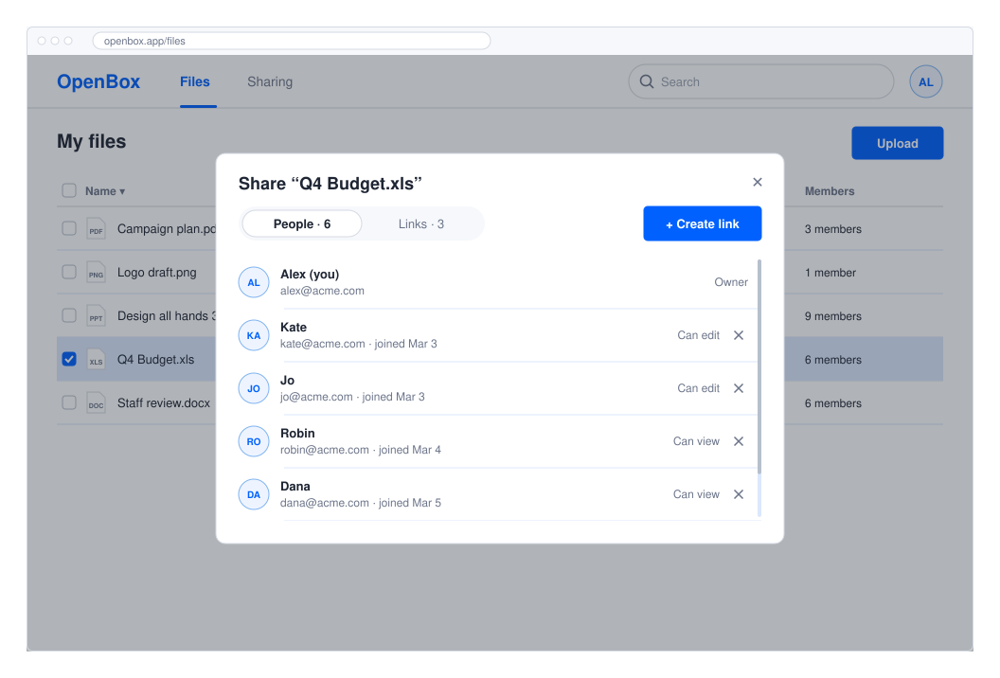 | 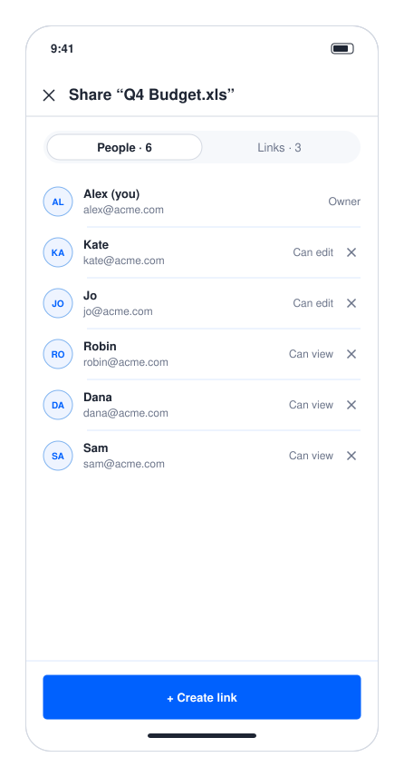 |

### Share: links

Each link shows what it gives, when it expires and how many people joined through it. Delete removes the link and everyone who joined through it.

| Desktop | Mobile |
|---|---|
|  | 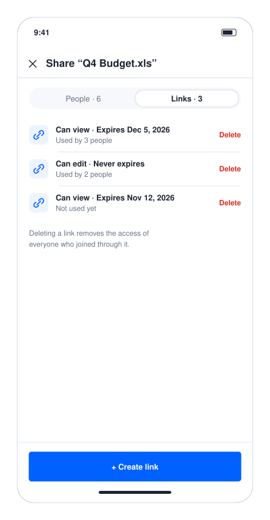 |

### Create link

Pick what the link allows and when it expires: 1 day, 7 days or 30 days from now, never, or the end of a chosen day in your time zone. Days before today can't be picked. View can't be unticked. On mobile, the date opens the app's own calendar sheet.

| Desktop | Mobile |
|---|---|
| 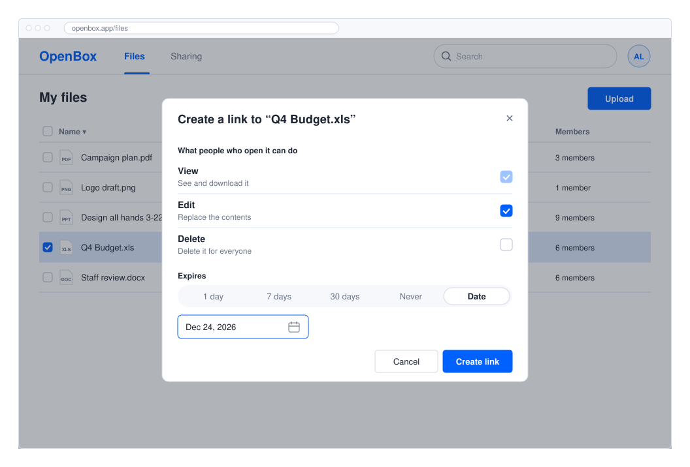 | 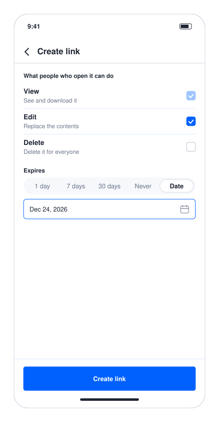 |

### Link created

Done (× on mobile) closes it; the link then shows in Share: links, without its URL.

| Desktop | Mobile |
|---|---|
|  |  |

### Other confirmations

Replace and every action that removes access ask first too. On mobile each is the same dialog at full width. Delete a link names how many people still have access through it, and with none says only that it stops working.

| Desktop | Mobile |
|---|---|
|  | 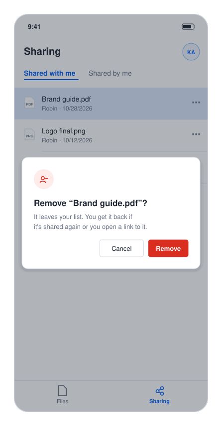 |

### Search

Typing 2+ characters replaces the list with matching names from your files and files shared with you. Owner shows whose file each result is. Clearing the box goes back to the list you were in.

| Desktop | Mobile |
|---|---|
| 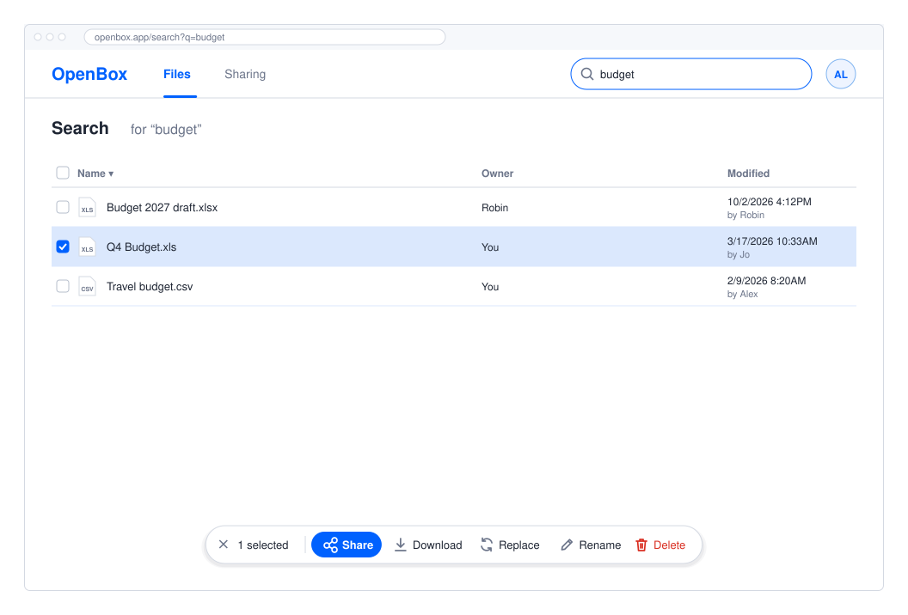 | 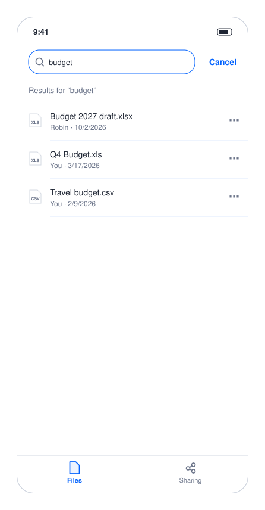 |

### Empty states

Every list has an empty state: My files, Shared with me, Shared by me, search and Share: links. Upload shows only in My files.

| Desktop | Mobile |
|---|---|
|  | 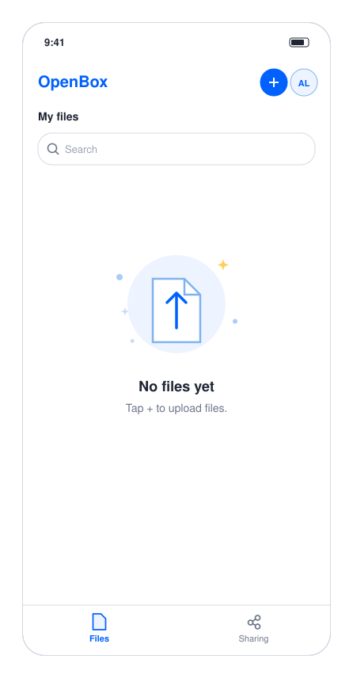 |

### Loading

Lists show placeholder rows until the first page arrives, and the Share dialog uses the same rows. Opening a share link shows the mobile page while it's redeemed; desktop shows the same in the page centre. A button that sends a request shows a spinner and ignores clicks until it answers. Scrolling to the end adds placeholder rows under the list; if that page fails, a Try again row replaces them, and after `invalid_after` the list reloads from the top.

| Desktop | Mobile |
|---|---|
| 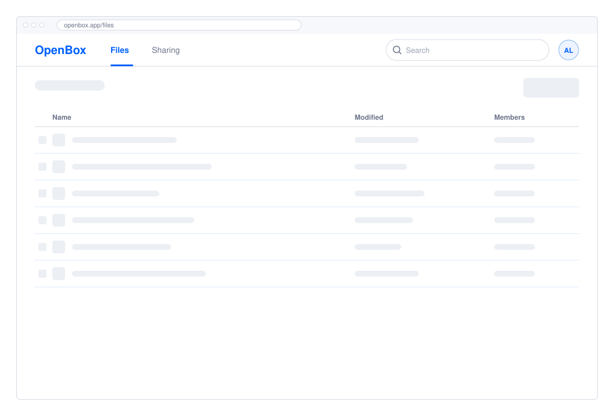 |  |

### Page errors

A failed load offers Try again. A link that expired, was deleted, was never valid or no longer lets you in says why and offers a way out.

| Desktop | Mobile |
|---|---|
| 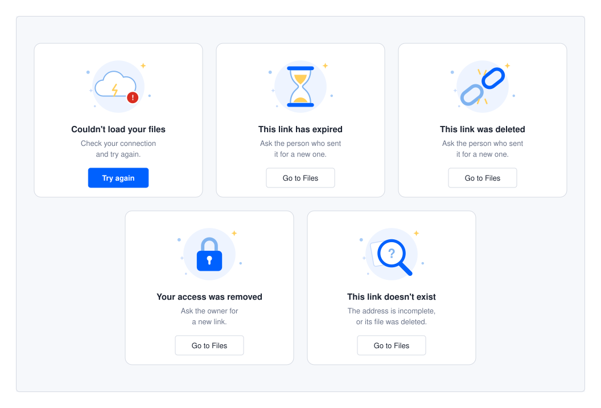 |  |

### Action and input errors

A failed action shows a toast naming each file that failed, from its error message or, for an id, the name the app already shows; in bulk actions, the files that succeeded stay done. Input errors show under the field. After a 401 the app signs in again and returns to the same page.

| Desktop | Mobile |
|---|---|
| 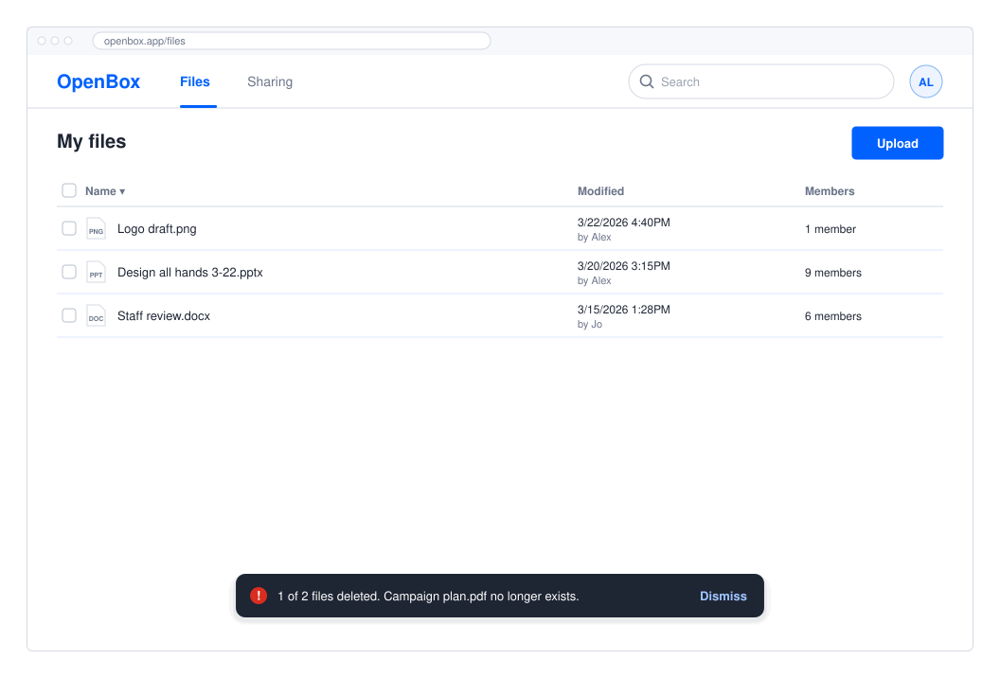 | 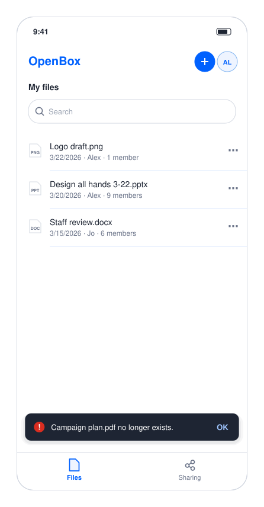 |

## 4. API

Base URL `https://<domain>/api/v1`. A single API instance serves every request, and there are no background jobs: all work happens inside the request that asks for it. Every request carries the session cookie set by sign-in. Every `POST` carries an `Idempotency-Key`; repeating a request with the same key returns the first response instead of doing the work twice. Keys are per user and kept for 24 hours. A `POST` without a key gets `400 missing_idempotency_key`; reusing a key for a different request gets `422 idempotency_key_reused`, and while the first request is still running, `409 request_in_progress`.

### 4.1 Files

#### List files — `GET /files`

Lists one page of files for any list screen: My files, Shared with me, Shared by me, or search results. Pass at most one of `shared_with_me`, `shared_by_me`, `q`; with none, it lists your own files.

```http
GET /api/v1/files?shared_with_me=true&sort=name&order=asc&limit=50
```

| Parameter | Values |
|---|---|
| `shared_with_me` | `true`: files other people shared with you |
| `shared_by_me` | `true`: your files that someone else has access to |
| `q` | Name search, at least 2 characters. Matches your own files and files shared with you |
| `sort` | `name` (default) or `modified_at` |
| `order` | `asc` (default) or `desc` |
| `limit` | 1–200, default 50 |
| `after` | Id of the last file on the previous page; the next page starts right after it in the same `sort` and `order` |

```http
HTTP/1.1 200 OK

{
  "data": {
    "viewer": {
      "id": "a91d4e07-2c3b-4f58-8e6a-0b7c9d1e2f34",
      "display_name": "Kate",
      "email": "kate@acme.com"
    },
    "upload_policy": null,                // set only when listing your own files
    "items": [
      {                                         // File — the same object everywhere below
        "id": "b5d8e3a1-0f7c-4c29-9e6b-3a2d8f1c7e40",
        "name": "Q4 Budget.xls",
        "owner": { "id": "3f6b1c2e-8d4a-4e71-9b2c-5a0f7d9e41c8", "display_name": "Alex" },
        "mime_type": "application/vnd.ms-excel",
        "size_bytes": 183223,
        "access": "granted",                    // "owner" | "granted"
        "permissions": ["view", "edit"],        // what you may do
        "member_count": 6,                      // owner included
        "modified_at": "2026-03-17T09:33:00Z",
        "modified_by": { "id": "c81d4f2e-6a3b-4d9c-8e1f-2b7a5c0d9e46", "display_name": "Jo" },
        "grants": [                             // [] unless it is shared with you
          {
            "link_id": "7b2e4d9a-1c8f-4a3e-b6d5-0f9c2a7e4b61",   // the link you joined through
            "permissions": ["view", "edit"],
            "granted_at": "2026-03-03T10:00:00Z"
          }
        ]
      }
    ],
    "has_more": false                     // true when another page follows
  },
  "errors": []
}
```

A file's `permissions` are all three on files you own, and what your links gave you on shared files. Rename and Share show only on files you own; Remove my access shows when `access` is `"granted"`; Download shows when exactly one file is selected.

When listing your own files, `upload_policy` is:

```json
{
  "max_file_bytes": 26214400,
  "allowed_extensions": [
    "pdf", "png", "jpg", "jpeg", "gif", "webp", "doc", "docx", "xls", "xlsx",
    "ppt", "pptx", "odt", "ods", "odp", "rtf", "txt", "csv", "md"
  ]
}
```

| Status | `code` | When |
|---|---|---|
| `401` | `unauthenticated` | No valid session |
| `422` | `validation_failed` | More than one filter, `q` shorter than 2 characters, or a bad `sort`, `order` or `limit` |
| `422` | `invalid_after` | `after` isn't a file in this list, e.g. it was deleted; reload from the start |

#### Rename — `POST /files/{id}/rename`

Renames a file and updates its `modified_at` and `modified_by`. Only the owner can rename.

```http
POST /api/v1/files/f7a2c9e4-1b6d-4f83-a0e5-7c4b2d9f1a68/rename
Idempotency-Key: 5d2c8a71-3e4f-4b9a-8c6d-1a7e0f3b9d52

{ "name": "Staff review 2026.docx" }
```

```http
HTTP/1.1 200 OK

{
  "data": {
    "id": "f7a2c9e4-1b6d-4f83-a0e5-7c4b2d9f1a68",
    "name": "Staff review 2026.docx",
    "owner": { "id": "3f6b1c2e-8d4a-4e71-9b2c-5a0f7d9e41c8", "display_name": "Alex" },
    "mime_type": "application/vnd.openxmlformats-officedocument.wordprocessingml.document",
    "size_bytes": 48211,
    "access": "owner",
    "permissions": ["view", "edit", "delete"],
    "member_count": 6,
    "modified_at": "2026-11-05T09:41:00Z",
    "modified_by": { "id": "3f6b1c2e-8d4a-4e71-9b2c-5a0f7d9e41c8", "display_name": "Alex" },
    "grants": []
  },
  "errors": []
}
```

| Status | `code` | When |
|---|---|---|
| `401` | `unauthenticated` | No valid session |
| `403` | `forbidden` | You don't own the file |
| `404` | `not_found` | The file doesn't exist or you can't see it |
| `409` | `name_conflict` | You already have a file with that name |
| `415` | `unsupported_file_type` | The new extension isn't allowed or doesn't match the file's type |
| `422` | `validation_failed` | Empty name, over 255 characters, or contains `/` |

#### Delete — `POST /files/delete`

Deletes files permanently, for everyone. Needs `delete` on each file. Each error's `message` names the file; for one that doesn't exist or you can't see, it gives the id you sent.

```http
POST /api/v1/files/delete
Idempotency-Key: 7f4e1b9c-0a3d-4e6b-8d2f-5c9a1e7b3f60

{ "ids": ["f7a2c9e4-1b6d-4f83-a0e5-7c4b2d9f1a68", "c4e9a2d7-6f3b-4a18-8c5e-1b7d0f9a3e26"] }
```

```http
HTTP/1.1 200 OK

{
  "data": ["f7a2c9e4-1b6d-4f83-a0e5-7c4b2d9f1a68"],
  "errors": [
    {
      "code": "not_found",
      "message": "File c4e9a2d7-6f3b-4a18-8c5e-1b7d0f9a3e26 no longer exists."
    }
  ]
}
```

| Status | `code` | When |
|---|---|---|
| `401` | `unauthenticated` | No valid session |
| `422` | `validation_failed` | `ids` is empty or has more than 100 entries |
| per item | `forbidden` | You don't have `delete` |
| per item | `not_found` | The file doesn't exist or you can't see it |

#### Remove my access — `POST /files/remove-access`

Removes files shared with you from your list by deleting all your grants on them, so you leave Share: people and `member_count`. The owner and everyone else keep their access. Each error's `message` gives the id you sent.

```http
POST /api/v1/files/remove-access
Idempotency-Key: 2a8d5f3c-7b1e-4c9a-a6d0-3e5f8b2c7a14

{ "ids": ["8e3b1f6d-2a9c-4d7e-b5f0-6c1a9d4e2b78"] }
```

```http
HTTP/1.1 200 OK

{ "data": ["8e3b1f6d-2a9c-4d7e-b5f0-6c1a9d4e2b78"], "errors": [] }
```

| Status | `code` | When |
|---|---|---|
| `401` | `unauthenticated` | No valid session |
| `422` | `validation_failed` | `ids` is empty or has more than 100 entries |
| per item | `not_found` | The file isn't shared with you |

#### Download — `POST /files/{id}/download`

Returns a signed storage URL, valid for 60 seconds, that saves the file under its real name. Needs `view`. Files are downloaded one at a time.

```http
POST /api/v1/files/b5d8e3a1-0f7c-4c29-9e6b-3a2d8f1c7e40/download
Idempotency-Key: 9b3e6a1d-4c8f-4b2e-a7d5-1f0c3e9a6b82
```

```http
HTTP/1.1 200 OK

{
  "data": {
    "url": "https://store.blob.vercel-storage.com/files/b5d8e3a1-0f7c-4c29-9e6b-3a2d8f1c7e40/Q4%20Budget.xls?download=1&token=4d7e9a2c1f8b",
    "expires_at": "2026-11-05T10:01:00Z"
  },
  "errors": []
}
```

| Status | `code` | When |
|---|---|---|
| `401` | `unauthenticated` | No valid session |
| `404` | `not_found` | The file doesn't exist or you can't see it |

### 4.2 Uploads

#### Start upload — `POST /uploads`

Reserves new files among your own files and returns where to send each one's bytes. Each name stays reserved until the upload finishes or expires; starting the same name again replaces your own pending upload. Rejected files are listed in `errors`, each `message` naming the file; the rest can be uploaded, and if all are rejected the response is still `201` with `data: []`.

```http
POST /api/v1/uploads
Idempotency-Key: 4e7c1a9b-2d5f-4a3e-8b6c-0d9f2e5a7c31

{
  "files": [
    {
      "name": "Q1 Budget.xlsx",
      "size_bytes": 201734,
      "mime_type": "application/vnd.openxmlformats-officedocument.spreadsheetml.sheet"
    },
    {
      "name": "Brand brief v2.pdf",
      "size_bytes": 1992294,
      "mime_type": "application/pdf"
    }
  ]
}
```

```http
HTTP/1.1 201 Created

{
  "data": [
    {                                     // Upload — the same object everywhere below
      "id": "4c7b2e9f-8a3d-4b1c-a6e4-9f0d2c5b8e73",
      "name": "Q1 Budget.xlsx",
      "put_url": "https://store.blob.vercel-storage.com/uploads/4c7b2e9f-8a3d-4b1c-a6e4-9f0d2c5b8e73?token=8f2c1a9e5d3b",
      "put_headers": {
        "content-type": "application/vnd.openxmlformats-officedocument.spreadsheetml.sheet"
      },
      "expires_at": "2026-11-05T10:15:00Z"
    },
    {
      "id": "6d1f8a3c-2e7b-4c9d-b5a0-3f8e1c6d9b42",
      "name": "Brand brief v2.pdf",
      "put_url": "https://store.blob.vercel-storage.com/uploads/6d1f8a3c-2e7b-4c9d-b5a0-3f8e1c6d9b42?token=c41e7b2a9d05",
      "put_headers": { "content-type": "application/pdf" },
      "expires_at": "2026-11-05T10:15:00Z"
    }
  ],
  "errors": []
}
```

| Status | `code` | When |
|---|---|---|
| `401` | `unauthenticated` | No valid session |
| `422` | `validation_failed` | `files` is empty or has more than 100 entries, or a malformed body |
| per file | `unsupported_file_type` | The extension isn't allowed or doesn't match `mime_type` |
| per file | `file_too_large` | Over 25 MB |
| per file | `name_conflict` | You already have a file with that name |
| per file | `validation_failed` | Empty name, over 255 characters, or contains `/` |

#### Replace contents — `POST /files/{id}/replace`

Starts an upload that replaces a file's contents. Finish it with `POST /uploads/{id}/complete`; the old contents are then deleted. Needs `edit`.

```http
POST /api/v1/files/b5d8e3a1-0f7c-4c29-9e6b-3a2d8f1c7e40/replace
Idempotency-Key: 6a2f9d4c-1e7b-4d3a-9c8e-5b0a7f2d4e16

{ "size_bytes": 190112, "mime_type": "application/vnd.ms-excel" }
```

```http
HTTP/1.1 201 Created

{
  "data": {
    "id": "5e8a2c7f-9b3d-4f1a-8c6e-0d2b7f4a9c13",
    "name": "Q4 Budget.xls",
    "put_url": "https://store.blob.vercel-storage.com/uploads/5e8a2c7f-9b3d-4f1a-8c6e-0d2b7f4a9c13?token=2b7e4d91a6c0",
    "put_headers": { "content-type": "application/vnd.ms-excel" },
    "expires_at": "2026-11-05T10:20:00Z"
  },
  "errors": []
}
```

| Status | `code` | When |
|---|---|---|
| `401` | `unauthenticated` | No valid session |
| `403` | `forbidden` | You don't have `edit` |
| `404` | `not_found` | The file doesn't exist or you can't see it |
| `413` | `file_too_large` | Over 25 MB |
| `415` | `unsupported_file_type` | The type isn't allowed or doesn't match the file's extension |
| `422` | `validation_failed` | Malformed body |

#### Finish upload — `POST /uploads/{id}/complete`

Call after the `PUT` succeeds. Confirms the bytes arrived, then makes the file visible. A replace upload returns the same file, with the same id.

```http
POST /api/v1/uploads/4c7b2e9f-8a3d-4b1c-a6e4-9f0d2c5b8e73/complete
Idempotency-Key: 1d5b8e2a-9c3f-4e7d-b6a1-4f8c2d0e9a73
```

```http
HTTP/1.1 200 OK

{
  "data": {
    "id": "91f0c6b3-5d2e-4a7f-b4c9-8e3a1d6f2b05",
    "name": "Q1 Budget.xlsx",
    "owner": { "id": "3f6b1c2e-8d4a-4e71-9b2c-5a0f7d9e41c8", "display_name": "Alex" },
    "mime_type": "application/vnd.openxmlformats-officedocument.spreadsheetml.sheet",
    "size_bytes": 201734,
    "access": "owner",
    "permissions": ["view", "edit", "delete"],
    "member_count": 1,
    "modified_at": "2026-11-05T10:02:00Z",
    "modified_by": { "id": "3f6b1c2e-8d4a-4e71-9b2c-5a0f7d9e41c8", "display_name": "Alex" },
    "grants": []
  },
  "errors": []
}
```

| Status | `code` | When |
|---|---|---|
| `401` | `unauthenticated` | No valid session |
| `403` | `forbidden` | For a replace, you no longer have `edit` |
| `404` | `not_found` | No such upload, it isn't yours, or the file it replaces was deleted |
| `409` | `upload_incomplete` | The bytes haven't arrived yet |
| `410` | `upload_expired` | The upload wasn't finished within 15 minutes; start again |

### 4.3 Sharing

Only a file's owner can use these endpoints.

#### File access — `GET /files/{id}/permissions`

Who has access to a file and the links that gave it.

```http
GET /api/v1/files/b5d8e3a1-0f7c-4c29-9e6b-3a2d8f1c7e40/permissions
```

```http
HTTP/1.1 200 OK

{
  "data": {
    "file": { "id": "b5d8e3a1-0f7c-4c29-9e6b-3a2d8f1c7e40", "name": "Q4 Budget.xls" },
    "members": [
      {                                   // Member
        "user": {
          "id": "3f6b1c2e-8d4a-4e71-9b2c-5a0f7d9e41c8",
          "display_name": "Alex",
          "email": "alex@acme.com"
        },
        "access": "owner",
        "permissions": ["view", "edit", "delete"],   // what they hold
        "grants": []                      // one per link they joined through; [] for the owner
      },
      {
        "user": {
          "id": "a91d4e07-2c3b-4f58-8e6a-0b7c9d1e2f34",
          "display_name": "Kate",
          "email": "kate@acme.com"
        },
        "access": "granted",
        "permissions": ["view", "edit"],
        "grants": [
          {
            "link_id": "7b2e4d9a-1c8f-4a3e-b6d5-0f9c2a7e4b61",
            "permissions": ["view", "edit"],
            "granted_at": "2026-03-03T10:00:00Z"
          }
        ]
      },
      {
        "user": {
          "id": "c81d4f2e-6a3b-4d9c-8e1f-2b7a5c0d9e46",
          "display_name": "Jo",
          "email": "jo@acme.com"
        },
        "access": "granted",
        "permissions": ["view", "edit"],
        "grants": [
          {
            "link_id": "7b2e4d9a-1c8f-4a3e-b6d5-0f9c2a7e4b61",
            "permissions": ["view", "edit"],
            "granted_at": "2026-03-03T11:20:00Z"
          }
        ]
      },
      {
        "user": {
          "id": "5c2e8f1a-7b4d-4a90-a3e1-6d8f0c2b9e57",
          "display_name": "Robin",
          "email": "robin@acme.com"
        },
        "access": "granted",
        "permissions": ["view"],
        "grants": [
          {
            "link_id": "d3a6f8b2-4c9e-4e1a-9b7d-6f2c0e8a5b31",
            "permissions": ["view"],
            "granted_at": "2026-03-04T09:15:00Z"
          }
        ]
      },
      {
        "user": {
          "id": "47b2e9c1-5d8a-4f3e-9b6c-1a0e7d4f2c85",
          "display_name": "Dana",
          "email": "dana@acme.com"
        },
        "access": "granted",
        "permissions": ["view"],
        "grants": [
          {
            "link_id": "d3a6f8b2-4c9e-4e1a-9b7d-6f2c0e8a5b31",
            "permissions": ["view"],
            "granted_at": "2026-03-05T11:30:00Z"
          }
        ]
      },
      {
        "user": {
          "id": "e9a4c7d2-3b1f-4e6a-8c5d-7f0b2a9e6d14",
          "display_name": "Sam",
          "email": "sam@acme.com"
        },
        "access": "granted",
        "permissions": ["view"],
        "grants": [
          {
            "link_id": "d3a6f8b2-4c9e-4e1a-9b7d-6f2c0e8a5b31",
            "permissions": ["view"],
            "granted_at": "2026-03-09T12:05:00Z"
          }
        ]
      }
    ],
    "links": [
      {                                   // Link
        "id": "d3a6f8b2-4c9e-4e1a-9b7d-6f2c0e8a5b31",
        "permissions": ["view"],                // what the link gives
        "expires_at": "2026-12-05T22:59:59Z",   // null = never
        "redemption_count": 3,
        "created_at": "2026-03-02T09:00:00Z"
      },
      {
        "id": "7b2e4d9a-1c8f-4a3e-b6d5-0f9c2a7e4b61",
        "permissions": ["view", "edit"],
        "expires_at": null,
        "redemption_count": 2,
        "created_at": "2026-03-02T14:20:00Z"
      },
      {
        "id": "4f9c1a7e-6d2b-4e8a-9c3f-2b5d8e0a6c47",
        "permissions": ["view"],
        "expires_at": "2026-11-12T22:59:59Z",
        "redemption_count": 0,
        "created_at": "2026-11-04T08:10:00Z"
      }
    ]
  },
  "errors": []
}
```

| Status | `code` | When |
|---|---|---|
| `401` | `unauthenticated` | No valid session |
| `403` | `forbidden` | You don't own the file |
| `404` | `not_found` | The file doesn't exist or you can't see it |

#### Remove people — `POST /files/{id}/members/remove`

Removes everything each person got through this file's links. They can't rejoin through the links that exist now, only through a link created later. Failed entries are listed in `errors`, each `message` naming the `user_id` you sent; the rest are removed. Returns the members left.

```http
POST /api/v1/files/b5d8e3a1-0f7c-4c29-9e6b-3a2d8f1c7e40/members/remove
Idempotency-Key: 5f9a2c7e-3b6d-4e1a-8f4c-7d2e0b5a9c38

{ "user_ids": ["5c2e8f1a-7b4d-4a90-a3e1-6d8f0c2b9e57"] }
```

```http
HTTP/1.1 200 OK

{
  "data": [
    {
      "user": {
        "id": "3f6b1c2e-8d4a-4e71-9b2c-5a0f7d9e41c8",
        "display_name": "Alex",
        "email": "alex@acme.com"
      },
      "access": "owner",
      "permissions": ["view", "edit", "delete"],
      "grants": []
    },
    {
      "user": {
        "id": "a91d4e07-2c3b-4f58-8e6a-0b7c9d1e2f34",
        "display_name": "Kate",
        "email": "kate@acme.com"
      },
      "access": "granted",
      "permissions": ["view", "edit"],
      "grants": [
        {
          "link_id": "7b2e4d9a-1c8f-4a3e-b6d5-0f9c2a7e4b61",
          "permissions": ["view", "edit"],
          "granted_at": "2026-03-03T10:00:00Z"
        }
      ]
    },
    {
      "user": {
        "id": "c81d4f2e-6a3b-4d9c-8e1f-2b7a5c0d9e46",
        "display_name": "Jo",
        "email": "jo@acme.com"
      },
      "access": "granted",
      "permissions": ["view", "edit"],
      "grants": [
        {
          "link_id": "7b2e4d9a-1c8f-4a3e-b6d5-0f9c2a7e4b61",
          "permissions": ["view", "edit"],
          "granted_at": "2026-03-03T11:20:00Z"
        }
      ]
    },
    {
      "user": {
        "id": "47b2e9c1-5d8a-4f3e-9b6c-1a0e7d4f2c85",
        "display_name": "Dana",
        "email": "dana@acme.com"
      },
      "access": "granted",
      "permissions": ["view"],
      "grants": [
        {
          "link_id": "d3a6f8b2-4c9e-4e1a-9b7d-6f2c0e8a5b31",
          "permissions": ["view"],
          "granted_at": "2026-03-05T11:30:00Z"
        }
      ]
    },
    {
      "user": {
        "id": "e9a4c7d2-3b1f-4e6a-8c5d-7f0b2a9e6d14",
        "display_name": "Sam",
        "email": "sam@acme.com"
      },
      "access": "granted",
      "permissions": ["view"],
      "grants": [
        {
          "link_id": "d3a6f8b2-4c9e-4e1a-9b7d-6f2c0e8a5b31",
          "permissions": ["view"],
          "granted_at": "2026-03-09T12:05:00Z"
        }
      ]
    }
  ],
  "errors": []
}
```

| Status | `code` | When |
|---|---|---|
| `401` | `unauthenticated` | No valid session |
| `403` | `forbidden` | You don't own the file |
| `404` | `not_found` | The file doesn't exist or you can't see it |
| `422` | `validation_failed` | `user_ids` is empty or has more than 100 entries |
| per entry | `not_found` | `user_id` has no access to this file |
| per entry | `forbidden` | `user_id` is you |

### 4.4 Links

#### Create link — `POST /files/{id}/links`

Creates a share link. Anyone who opens it and signs in gets its permissions. Only the owner can create links. For a chosen day the app sends the end of that day in the user's time zone; dates are shown in local time.

```http
POST /api/v1/files/b5d8e3a1-0f7c-4c29-9e6b-3a2d8f1c7e40/links
Idempotency-Key: 8c3d6f1a-2e9b-4a7c-b5d4-0e3f6a9c2b57

{
  "permissions": ["view", "edit"],
  "expires_at": "2026-12-24T22:59:59Z"    // null = never
}
```

```http
HTTP/1.1 201 Created

{
  "data": {
    "id": "e5c1a8d3-7b2f-4e9a-8d6c-1f3b5a7e9c20",
    "url": "https://<domain>/links/7Fq9xKpL2mZr",   // only in this response
    "permissions": ["view", "edit"],              // what the link gives
    "expires_at": "2026-12-24T22:59:59Z",
    "redemption_count": 0,
    "created_at": "2026-11-05T10:05:00Z"
  },
  "errors": []
}
```

| Status | `code` | When |
|---|---|---|
| `401` | `unauthenticated` | No valid session |
| `403` | `forbidden` | You don't own the file |
| `404` | `not_found` | The file doesn't exist or you can't see it |
| `422` | `validation_failed` | `expires_at` is in the past, an unknown permission, or a set without `view` |

#### Delete link — `POST /links/{id}/delete`

The URL stops working and everyone who joined through it loses that access. Only the file's owner can delete a link.

```http
POST /api/v1/links/d3a6f8b2-4c9e-4e1a-9b7d-6f2c0e8a5b31/delete
Idempotency-Key: 0e7a4c2f-5d8b-4f1e-9a3c-6b2d8f0e4a95
```

```http
HTTP/1.1 204 No Content
```

| Status | `code` | When |
|---|---|---|
| `401` | `unauthenticated` | No valid session |
| `403` | `forbidden` | You don't own the link's file |
| `404` | `not_found` | The link doesn't exist or you can't see it |

#### Redeem link — `POST /links/redeem`

Called by the web app's link page, `https://<domain>/links/{token}` (the URL people receive), after sign-in. Grants the link's permissions and returns the file, so the app can open Shared with me. Someone who already joined through another link gets this link's grant added. For the owner, or someone who still holds this link's grant, it returns the file and changes nothing, even after the link expires.

```http
POST /api/v1/links/redeem
Idempotency-Key: 3b6e9a2d-7c1f-4d5b-8e0a-2f4c7d9b1e63

{ "token": "7Fq9xKpL2mZr" }
```

```http
HTTP/1.1 200 OK

{
  "data": {
    "id": "b5d8e3a1-0f7c-4c29-9e6b-3a2d8f1c7e40",
    "name": "Q4 Budget.xls",
    "owner": { "id": "3f6b1c2e-8d4a-4e71-9b2c-5a0f7d9e41c8", "display_name": "Alex" },
    "mime_type": "application/vnd.ms-excel",
    "size_bytes": 190112,
    "access": "granted",
    "permissions": ["view", "edit"],
    "member_count": 7,
    "modified_at": "2026-11-05T10:06:00Z",
    "modified_by": { "id": "3f6b1c2e-8d4a-4e71-9b2c-5a0f7d9e41c8", "display_name": "Alex" },
    "grants": [
      {
        "link_id": "e5c1a8d3-7b2f-4e9a-8d6c-1f3b5a7e9c20",
        "permissions": ["view", "edit"],
        "granted_at": "2026-11-05T10:12:00Z"
      }
    ]
  },
  "errors": []
}
```

| Status | `code` | When |
|---|---|---|
| `401` | `unauthenticated` | Not signed in; go to `/auth/login?return_to=/links/7Fq9xKpL2mZr`, which comes back here |
| `403` | `forbidden` | The owner removed you after this link was created |
| `404` | `not_found` | The token doesn't match any link, or the link's file was deleted |
| `410` | `link_expired` | The link is past its `expires_at` |
| `410` | `link_deleted` | The link was deleted |
